# Coletta

Organizador pessoal de coleções: cada usuário cadastra suas coleções (discos, câmeras, bonecas, álbuns...)
e os itens de cada uma, em um acervo privado e isolado dos demais usuários.

**Aplicação em produção:** https://137.131.137.14

Projeto desenvolvido como atividade avaliativa da disciplina **Projeto Aplicado: Práticas de Mercado**
(pós-graduação Lato Sensu em Segurança da Informação e Análise Forense — UNCISAL), seguindo os princípios
de *Secure by Design* e *Secure by Default*. Este README é o **relatório técnico da entrega**.

## Sumário

1. [Funcionalidades](#1-funcionalidades)
2. [Stack](#2-stack)
3. [Arquitetura](#3-arquitetura)
4. [Como rodar localmente](#4-como-rodar-localmente)
5. [Segurança da aplicação (OWASP Top 10:2025)](#5-segurança-da-aplicação-owasp-top-102025)
6. [Infraestrutura](#6-infraestrutura)
7. [CI/CD](#7-cicd)
8. [Repositório e proteção de segredos](#8-repositório-e-proteção-de-segredos)
9. [Desenvolvimento com IA](#9-desenvolvimento-com-ia)
10. [Evidências](#10-evidências)
11. [Decisões e limitações](#11-decisões-e-limitações)
12. [Checklist da entrega](#12-checklist-da-entrega)

---

## 1. Funcionalidades

| Tela | Rota | Acesso |
|---|---|---|
| Login (e-mail e senha) | `/entrar/` | Público |
| Cadastro (nome, e-mail, senha, confirmação) | `/cadastro/` | Público |
| Início: totais reais de coleções e itens, última atualização, coleções recentes | `/` | Autenticado |
| Minhas coleções (cards com quantidade de itens) | `/colecoes/` | Autenticado |
| Criar / editar coleção, com capa opcional (imagem) | `/colecoes/nova/`, `/colecoes/<id>/editar/` | Dono |
| Imagem de capa da coleção | `/colecoes/<id>/capa/` | Dono |
| Detalhe da coleção: itens em cards, resumo por estado de conservação, filtros e ordenação | `/colecoes/<id>/` | Dono |
| Campos personalizados da coleção (criar, renomear, excluir) | `/colecoes/<id>/campos/` | Dono |
| Criar / editar item (com os campos personalizados da coleção) | `/colecoes/<id>/itens/novo/`, `/itens/<id>/editar/` | Dono |
| Ficha do item | `/itens/<id>/` | Dono |
| Confirmação de exclusão (avisa quantos itens serão removidos) | `.../excluir/` | Dono |
| Busca por nome de coleção ou item, edição do item ou tag (`#rara`), com sugestões em tempo real enquanto digita | `/busca/?q=` | Autenticado |
| Logout (botão em formulário POST) | `/sair/` | Autenticado |

**Dados catalogados:**

- **Coleção:** nome, categoria principal (lista fixa, como Música, Fotografia, Bonecas & Brinquedos), ano de
  início, tags, descrição e capa.
- **Item:** nome, subcategoria/edição, ano de lançamento ou aquisição, estado de conservação (Lacrado,
  Excelente, Bom, Regular, Danificado), local de guarda e notas do colecionador.
- **Campos personalizados:** cada coleção pode definir até 10 campos próprios, de texto ou número (ex.:
  "Gravadora" para discos, "Montagem da lente" para câmeras), que aparecem no cadastro e na ficha de todos os
  itens dela.

Todas as telas têm estado vazio, navegação estrutural (*breadcrumb*), mensagens de erro por campo (com ícone
e texto, nunca só por cor) e layout responsivo. O visual segue o protótipo feito no Figma (paleta, tipografia Plus Jakarta Sans e
componentes do *brand guide*).

## 2. Stack

| Camada | Tecnologia |
|---|---|
| Linguagem | Python 3.14 (gerenciado com [uv](https://docs.astral.sh/uv/)) |
| Framework | Django 6.1 (templates renderizados no servidor) |
| Front-end | HTML + CSS puro; cinco scripts próprios e pequenos em `static/js/` (busca em tempo real, filtros automáticos, modal de exclusão, prévia da capa e validação antes do envio), todos opcionais (sem JS tudo funciona); nada de CDN |
| Banco de dados | SQLite |
| Limite de tentativas de login | django-axes 8.3 |
| Processamento das capas | Pillow 13.0 |
| Servidor de aplicação | Gunicorn (serviço systemd com socket Unix) |
| Web server | Nginx 1.28 (proxy reverso, HTTPS, arquivos estáticos) |
| Certificado | Let's Encrypt via Certbot 5.8 (certificado para o IP) |
| Nuvem | Oracle Cloud Infrastructure (Always Free), Ubuntu Server 26.04 LTS |
| CI/CD | GitHub Actions |

## 3. Arquitetura

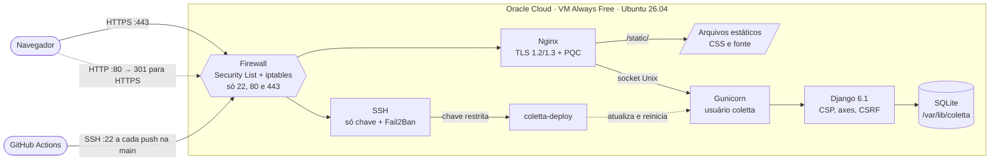

Modelo de dados:

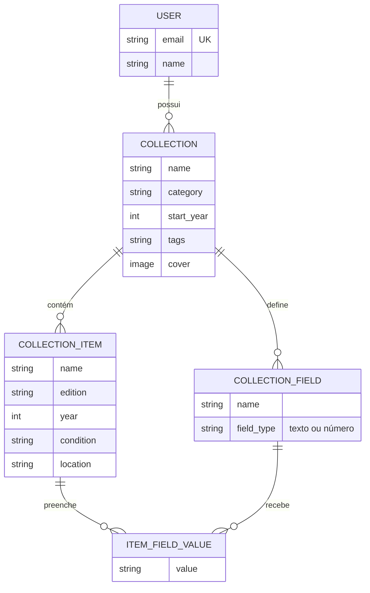

O item não tem dono próprio: pertence ao usuário por meio da coleção. O mesmo vale para os campos
personalizados e seus valores, e é isso que permite verificar a posse de tudo a partir da coleção.

Estrutura do código:

```
coletta/
├── accounts/          # usuário personalizado (login por e-mail), cadastro, rate limit, IP do cliente
├── colecoes/          # coleções, itens, tela inicial, busca (views, forms, testes de isolamento)
├── config/            # settings (segurança, CSP, logging), urls, wsgi
├── templates/         # páginas, parciais e páginas de erro (404, 500, 403)
├── static/            # CSS e fonte Plus Jakarta Sans (sem CDN)
├── deploy/            # configs do servidor: nginx, systemd, fail2ban, ssh, sudoers, script de deploy
├── .github/workflows/ # pipeline de CI/CD
├── CLAUDE.md          # contexto e regras de segurança passadas à IA
└── PLANO.md           # plano de execução por fases
```

## 4. Como rodar localmente

Pré-requisito: [uv](https://docs.astral.sh/uv/) instalado (ele baixa o Python 3.14 automaticamente).

```bash
git clone git@github.com:lauannyrb/coletta.git
cd coletta

uv venv                               # cria o .venv com Python 3.14 (.python-version)
uv pip install -r requirements.txt

cp .env.example .env                  # depois edite o .env (veja abaixo)
.venv/bin/python manage.py migrate
.venv/bin/python manage.py runserver
```

No `.env`, gere uma `SECRET_KEY` própria e, para desenvolvimento, use `DEBUG=True`:

```bash
.venv/bin/python -c "from django.core.management.utils import get_random_secret_key as g; print(g())"
```

Testes (81 testes automatizados):

```bash
.venv/bin/python manage.py test
```

Não existe usuário padrão nem senha fixa no código: o primeiro acesso é feito pela tela de cadastro.

**Acervo de demonstração (opcional, só em desenvolvimento):**

```bash
.venv/bin/python manage.py seed_demo          # cria a Ana (7 coleções, 29 itens, capas) e a Bia
.venv/bin/python manage.py seed_demo --reset  # apaga as contas de demonstração e recria tudo
```

O comando ([`colecoes/management/commands/seed_demo.py`](colecoes/management/commands/seed_demo.py)) **recusa rodar com `DEBUG=False`**,
então nunca cria contas em produção. As senhas são **aleatórias**, geradas a cada execução e mostradas
só no terminal. A Bia tem uma coleção própria, usada para demonstrar o teste de isolamento (a Ana recebe 404).

## 5. Segurança da aplicação (OWASP Top 10:2025)

O escopo exige no mínimo 3 categorias. As três principais mitigadas são **A01, A07 e A05**; as outras
três (**A02, A03 e A09**) foram tratadas como reforço.

| Categoria | Resumo da mitigação |
|---|---|
| **A01 – Broken Access Control** | Login obrigatório; toda consulta filtrada pelo dono; 404 para recursos de terceiros (anti-IDOR) |
| **A07 – Authentication Failures** | Hash de senha, validadores de senha, bloqueio por tentativas, rate limit no cadastro, mensagem genérica, sessão rotacionada e com prazo, logout por POST |
| **A05 – Injection** | ORM parametrizado, validação por formulários, escape automático nos templates, CSP restrita |
| **A02 – Security Misconfiguration** | `DEBUG` desligado por padrão, segredos no `.env`, HTTPS forçado, cookies seguros, cabeçalhos de segurança, admin desligado em produção, `check --deploy` sem avisos |
| **A03 – Software Supply Chain Failures** | Dependências fixadas, `pip-audit` a cada push, GitHub Actions fixadas por SHA, nenhum recurso de CDN |
| **A09 – Security Logging and Alerting Failures** | Falhas de login, bloqueios e eventos de segurança registrados no journal do servidor |

### A01 – Broken Access Control

O principal risco de um sistema multiusuário é um usuário acessar dados de outro trocando o ID na URL
(IDOR). No Coletta, **nenhuma consulta busca um objeto só pelo ID**:

- Coleções são sempre buscadas junto com o dono —
  [`colecoes/views.py#L34`](colecoes/views.py#L34):
  `get_object_or_404(Collection, pk=pk, user=request.user)`.
- Itens são buscados pela coleção do dono — [`colecoes/views.py#L38`](colecoes/views.py#L38):
  `get_object_or_404(CollectionItem, pk=pk, collection__user=request.user)`.
- Ao criar um item, a coleção de destino também passa pela verificação de dono
  ([`colecoes/views.py#L253`](colecoes/views.py#L253)); o ID vindo do navegador nunca é confiado.
- Listagens, totais e busca partem sempre do usuário logado
  ([`colecoes/views.py#L305`](colecoes/views.py#L305)).
- O dono é definido no servidor ([`colecoes/views.py#L88`](colecoes/views.py#L88)) e os formulários não
  têm campo `user` nem `collection` ([`colecoes/forms.py#L10`](colecoes/forms.py#L10)): um `user` forjado no
  POST é ignorado (há teste para isso).
- Todas as views privadas usam `@login_required`.
- Recurso de outro usuário responde **404**, idêntico ao de um ID inexistente, para não revelar se o
  registro existe.
- **Campos personalizados** seguem a mesma regra: são buscados pela coleção do dono
  ([`colecoes/views.py#L46`](colecoes/views.py#L46)), e o formulário do item só monta os campos da coleção
  do próprio item ([`colecoes/forms.py#L132`](colecoes/forms.py#L132)). Um ID de campo de outra coleção
  enviado no POST é simplesmente ignorado (testado em
  [`colecoes/tests.py#L519`](colecoes/tests.py#L519)).
- Exclusões só acontecem por POST (o GET apenas mostra a confirmação).
- O `/admin/` do Django só existe em desenvolvimento ([`config/urls.py#L28`](config/urls.py#L28)).

**Teste de acesso cruzado** ([`colecoes/tests.py#L192`](colecoes/tests.py#L192)): a usuária B tenta ver,
editar e excluir a coleção da usuária A, editar e excluir um item dela e criar um item na coleção dela.
Todas as tentativas recebem 404 e nada é alterado:

```
$ python manage.py test colecoes.tests.AccessControlTests -v 2
test_404_igual_para_id_inexistente_e_de_outro_usuario ... ok
test_404_usa_pagina_propria_sem_detalhes_tecnicos ... ok
test_listagem_nao_mostra_colecoes_de_outro_usuario ... ok
test_nao_acessa_edita_nem_exclui_colecao_de_outro_usuario ... ok
test_nao_acessa_nem_modifica_item_de_outro_usuario ... ok
test_nao_cria_item_em_colecao_de_outro_usuario ... ok
test_paginas_privadas_exigem_login ... ok
Ran 7 tests ... OK
```

### A07 – Authentication Failures

- **Senhas:** hash do Django (PBKDF2) e os 4 validadores de senha ativos
  ([`config/settings.py#L147`](config/settings.py#L147)): tamanho mínimo, senha comum, só números,
  parecida com os dados do usuário.
- **Força bruta no login:** django-axes bloqueia o IP por 1 hora após 5 falhas
  ([`config/settings.py#L124`](config/settings.py#L124)), respondendo 429. A contagem **não** é zerada no
  login bem-sucedido, para que um atacante com conta própria não possa "resetar" o contador entre
  tentativas.
- **Cadastro em massa:** limite de 10 envios por hora por IP
  ([`accounts/views.py#L10`](accounts/views.py#L10), [`accounts/ratelimit.py#L9`](accounts/ratelimit.py#L9)).
- **IP real do cliente:** atrás do Nginx, o IP vem do cabeçalho `X-Real-IP`, que o Nginx sobrescreve
  ([`deploy/nginx/coletta.conf#L58`](deploy/nginx/coletta.conf#L58)); o cabeçalho só é aceito quando o
  sistema está configurado como atrás de proxy ([`accounts/utils.py#L4`](accounts/utils.py#L4)), para não
  ser forjado.
- **Mensagem genérica:** "E-mail ou senha inválidos.", sem dizer qual dos dois errou
  ([`accounts/forms.py#L43`](accounts/forms.py#L43)).
- **E-mail único sem diferenciar maiúsculas:** salvo sempre em minúsculas
  ([`accounts/models.py#L52`](accounts/models.py#L52)) e validado no cadastro
  ([`accounts/forms.py#L23`](accounts/forms.py#L23)).
- **Sessão:** `login()` gera uma nova chave de sessão; a sessão expira em 8 horas, com cookie `HttpOnly`
  e `Secure` ([`config/settings.py#L217`](config/settings.py#L217)).
- **Logout:** só por POST com token CSRF ([`accounts/urls.py#L17`](accounts/urls.py#L17)); um GET em
  `/sair/` recebe 405.
- Não há usuário padrão nem credencial fixa no código.

### A05 – Injection

- **SQL:** todo acesso ao banco usa o ORM do Django, que gera consultas parametrizadas. Não existe SQL
  escrito à mão no projeto. A busca usa `icontains` em nome, edição e tags
  ([`colecoes/views.py#L312`](colecoes/views.py#L312)), com o termo limitado a 100 caracteres.
- **Parâmetros de filtro e ordenação:** na lista de itens, a ordenação vem de uma lista fechada
  ([`colecoes/views.py#L23`](colecoes/views.py#L23)) e o estado de conservação só é aceito se for um dos
  valores conhecidos ([`colecoes/views.py#L101`](colecoes/views.py#L101)); qualquer outro valor é ignorado. O
  texto da URL nunca vira nome de coluna nem parte de consulta.
- **Tags:** normalizadas e validadas no servidor ([`colecoes/forms.py#L16`](colecoes/forms.py#L16)): só
  letras, números e hífen, até 8 tags de 30 caracteres.
- **Entrada de dados:** todos os dados passam por `Form`/`ModelForm`, que validam tipo, campos
  obrigatórios, espaços e tamanho máximo antes de chegar ao banco.
- **XSS:** os templates do Django escapam automaticamente qualquer conteúdo vindo do usuário. Além disso,
  a **Content Security Policy** ([`config/settings.py#L225`](config/settings.py#L225)) só permite scripts,
  estilos e fontes do próprio servidor: mesmo que algum HTML fosse injetado, um script inline ou externo
  não seria executado. Os templates não têm nenhum JavaScript nem CSS inline.
  A única exceção é `blob:` em `img-src`, **só para imagens**: é o endereço temporário da prévia da capa
  escolhida, gerada no próprio navegador antes do envio. Scripts continuam restritos a `'self'`.
- **Busca em tempo real:** o `static/js/busca.js` pede à mesma view da busca um trecho de HTML
  (`/busca/?q=...&parcial=1`), renderizado e escapado pelo template `templates/partials/search_live.html`,
  com as mesmas consultas filtradas pelo dono. O script nunca monta HTML com o texto digitado. Sem JavaScript,
  a busca continua funcionando pelo formulário normal.
- **Modal de exclusão:** o `static/js/confirmar.js` abre um `<dialog>` que envia **POST com token CSRF**
  para a mesma URL da página de confirmação. Os textos do modal vêm de atributos `data-*` escapados pelo
  template e são inseridos com `textContent`. Sem JavaScript, o link abre a página de confirmação (o GET
  nunca exclui nada).
- **CSRF:** token obrigatório em todos os formulários POST.

### Upload das capas das coleções

O upload de arquivo é uma das portas de entrada mais perigosas de uma aplicação web. A capa da coleção
foi implementada com várias camadas de proteção ([`colecoes/images.py#L17`](colecoes/images.py#L17)):

- **Tipo validado pelo conteúdo, não pela extensão:** só JPEG, PNG e WEBP. O `Image.open` recebe a lista de
  formatos permitidos ([`colecoes/images.py#L30`](colecoes/images.py#L30)), então arquivos GIF, TIFF, PDF,
  XBM etc. nem chegam aos parsers desses formatos. Um texto renomeado para `.png` é recusado.
- **Limites:** 2 MB por arquivo, 25 milhões de pixels (contra "bombas" de descompressão: um PNG pequeno em
  bytes que ocuparia gigabytes de memória) e `client_max_body_size 3m` no Nginx
  ([`deploy/nginx/coletta.conf#L28`](deploy/nginx/coletta.conf#L28)).
- **Imagem regravada:** a foto é redimensionada (lado maior de 1600 px) e salva de novo em WEBP. Isso remove
  metadados EXIF, como a localização GPS de fotos de celular, e qualquer conteúdo escondido junto da
  imagem (arquivos "poliglotas").
- **Nome aleatório** (`capas/<uuid>.webp`): o nome enviado pelo usuário nunca é usado.
- **Prévia no navegador** (`static/js/capa.js`): mostra a imagem escolhida e já avisa sobre formato ou
  tamanho errados, mas é só conveniência. Toda a validação acima acontece de novo no servidor.
- **Fora da pasta pública:** os arquivos ficam em `/var/lib/coletta/media`, com permissão `600`
  ([`config/settings.py#L185`](config/settings.py#L185)). O Nginx não os serve; não existe URL pública.
- **Acesso só pelo dono:** a imagem é entregue por uma view que usa a mesma verificação de dono das
  coleções ([`colecoes/views.py#L165`](colecoes/views.py#L165)); para outro usuário, 404.
- **Limpeza:** a capa antiga é apagada do disco ao trocar, remover ou excluir a coleção
  ([`colecoes/models.py#L150`](colecoes/models.py#L150)).

Testes em [`colecoes/tests.py#L269`](colecoes/tests.py#L269): arquivo falso, formato não permitido, arquivo
grande demais, dimensões gigantes, remoção do EXIF, acesso por outro usuário e limpeza dos arquivos.

### A02 – Security Misconfiguration

- `SECRET_KEY` só existe no `.env` (o Django não sobe sem ela) e `DEBUG` é `False` se não for
  explicitamente ligado ([`config/settings.py#L31`](config/settings.py#L31)).
- Em produção ([`config/settings.py#L243`](config/settings.py#L243)): redirecionamento para HTTPS,
  cookies `Secure`, `CSRF_TRUSTED_ORIGINS` e CSP aplicada.
- Cabeçalhos enviados: `Content-Security-Policy`, `Strict-Transport-Security` (pelo Nginx),
  `X-Frame-Options: DENY`, `X-Content-Type-Options: nosniff`, `Referrer-Policy: same-origin` e
  `Cross-Origin-Opener-Policy: same-origin`.
- `python manage.py check --deploy` passa **sem nenhum aviso** e roda com `--fail-level WARNING` no
  pipeline e no script de deploy: um aviso de segurança barra a publicação.
- Páginas de erro próprias (404, 500, 403) sem detalhes técnicos.

### A03 – Software Supply Chain Failures

- Versões exatas de todas as dependências em [`requirements.txt`](requirements.txt).
- `pip-audit` verifica vulnerabilidades conhecidas a cada push
  ([`.github/workflows/deploy.yml#L51`](.github/workflows/deploy.yml#L51)); se encontrar alguma, o deploy
  não acontece.
- As GitHub Actions são fixadas pelo SHA do commit, não só pela tag
  ([`.github/workflows/deploy.yml#L27`](.github/workflows/deploy.yml#L27)), o que impede que uma tag
  alterada maliciosamente seja usada.
- Nenhum CSS, JavaScript ou fonte vem de CDN: tudo é servido pelo próprio servidor.

### A09 – Security Logging and Alerting Failures

Configuração em [`config/settings.py#L262`](config/settings.py#L262). Os logs vão para o journal do
systemd no servidor (`journalctl -u coletta.service`):

- **django-axes:** cada falha de login e cada bloqueio, com IP de origem (o e-mail tentado é mascarado).
- **django.security:** token CSRF inválido, cabeçalho `Host` não permitido etc.
- **django.request:** erros 500.
- No servidor, o Fail2Ban registra e bane IPs que erram o SSH (ver seção 6).

## 6. Infraestrutura

| Item | Configuração |
|---|---|
| Provedor | Oracle Cloud Infrastructure, região São Paulo, recursos **Always Free** |
| VM | `VM.Standard.E2.1.Micro` (1 OCPU AMD, 1 GB RAM + 2 GB de swap) |
| Sistema | **Ubuntu Server 26.04 LTS** (OpenSSL 3.5.5) |
| Acesso público | IP **137.131.137.14** (sem domínio) |

### SSH somente com chave

Arquivo [`deploy/ssh/00-coletta.conf`](deploy/ssh/00-coletta.conf), instalado em
`/etc/ssh/sshd_config.d/`: `PasswordAuthentication no`, `KbdInteractiveAuthentication no`,
`PermitRootLogin no`. O prefixo `00-` garante prioridade sobre o arquivo da imagem da nuvem
(`50-cloud-init.conf`), já que o `sshd` usa o primeiro valor encontrado. Confirmado com `sshd -T`.

### Firewall: apenas 22, 80 e 443

As portas são liberadas em **duas camadas**:
1. **Security List da VCN** na Oracle Cloud: entrada apenas TCP 22, 80 e 443.
2. **iptables da própria VM** (`/etc/iptables/rules.v4`): a imagem Ubuntu da Oracle bloqueia tudo
   exceto a 22; foram adicionadas a 80 e a 443 antes da regra `REJECT` final.

### Fail2Ban

Arquivo [`deploy/fail2ban/jail.local`](deploy/fail2ban/jail.local): jail `sshd` com **`maxretry = 4`**,
**`bantime = 24h`** e `findtime = 10m`.

Foi necessário usar `mode = aggressive`: como o servidor não aceita senha, os robôs da internet só geram
linhas do tipo `Connection closed by authenticating user root ... [preauth]`, que o modo padrão não conta
como falha. O teste com `fail2ban-regex` no log real mostrou **0 falhas detectadas no modo normal e 6 no
modo aggressive**.

**Teste de banimento:** feito a partir de outro IP (celular em dados móveis); o IP foi banido e aparece
em `fail2ban-client status sshd`. No modo aggressive uma tentativa de SSH gera cerca de duas linhas de
falha no log, então o banimento acontece por volta da 2ª tentativa, mais rígido que o mínimo exigido
(`maxretry` continua 4).

### Aplicação

- Usuário de sistema próprio, `coletta` (não root, sem senha).
- Código em `/srv/coletta/app`; **banco, cache e capas em `/var/lib/coletta`**, fora da pasta atualizada
  pelo deploy e fora da pasta servida pelo Nginx.
- Gunicorn como serviço systemd ativado por socket Unix
  ([`deploy/systemd/`](deploy/systemd/)), com endurecimento: `ProtectSystem=strict` (só pode escrever em
  `/var/lib/coletta`), `NoNewPrivileges`, `PrivateTmp`, `ProtectHome` e outros.
- O socket só aceita conexões do usuário do Nginx (`www-data`, modo `0600`).
- `.env` de produção criado no servidor (`chmod 600`), com `SECRET_KEY` própria.

### HTTPS com certificado para o IP

- **Certbot 5.8** (snap), certificado Let's Encrypt **emitido para o IP 137.131.137.14**, chave ECDSA.
- A Let's Encrypt exige o perfil **`shortlived`** para certificados de IP: validade de **6 dias**. A
  renovação automática é feita pelo timer `snap.certbot.renew.timer`, com `renew_hook = systemctl reload
  nginx` para o Nginx carregar o certificado novo. Testada com `certbot renew --dry-run`.
- Validação pelo modo *webroot* (o Nginx continua no ar durante a emissão).

Comando de emissão:

```bash
sudo certbot certonly --preferred-profile shortlived \
  --webroot --webroot-path /var/www/certbot \
  --ip-address 137.131.137.14 --deploy-hook "systemctl reload nginx"
```

### Nginx: TLS e PQC

Arquivo [`deploy/nginx/coletta.conf`](deploy/nginx/coletta.conf):

- Porta 80 só responde à validação do Let's Encrypt; todo o resto recebe **301 para HTTPS**
  ([linha 17](deploy/nginx/coletta.conf#L17)).
- Apenas **TLS 1.2 e 1.3** ([linha 34](deploy/nginx/coletta.conf#L34)); no TLS 1.2, só cifras ECDHE com
  AEAD (AES-GCM e ChaCha20).
- **Troca de chaves pós-quântica:** `ssl_ecdh_curve X25519MLKEM768:X25519:prime256v1:secp384r1`
  ([linha 36](deploy/nginx/coletta.conf#L36)). O grupo híbrido X25519 + ML-KEM-768 é oferecido primeiro;
  os clássicos ficam como alternativa para clientes antigos. Funciona com o OpenSSL 3.5 do Ubuntu 26.04.
- HSTS (`max-age=31536000`) em todas as respostas, inclusive arquivos estáticos.
- `server_tokens off` (não expõe a versão do Nginx).

Verificação no próprio servidor:

```
$ openssl s_client -connect 137.131.137.14:443 -groups X25519MLKEM768
Negotiated TLS1.3 group: X25519MLKEM768
Protocol: TLSv1.3
```

### Resultado dos testes de TLS

| Ferramenta | Critério | Resultado |
|---|---|---|
| [SSL.org](https://www.ssl.org/) | Certificate Trusted | **Yes** |
| SSL.org | Algorithm / Key Type & Size | **sha384 / EC 256 bits · Good signature · Good key** |
| SSL.org | Versões de TLS | **TLSv1.2, TLSv1.3** (cadeia válida e completa) |
| [DigiCert PQC checker](https://www.digicert.com/pqc-checker) | TLS 1.3 + troca de chaves quântica-segura | **Pass** nos 2 testes |

## 7. CI/CD

Workflow [`.github/workflows/deploy.yml`](.github/workflows/deploy.yml), disparado a cada
`git push origin main`:

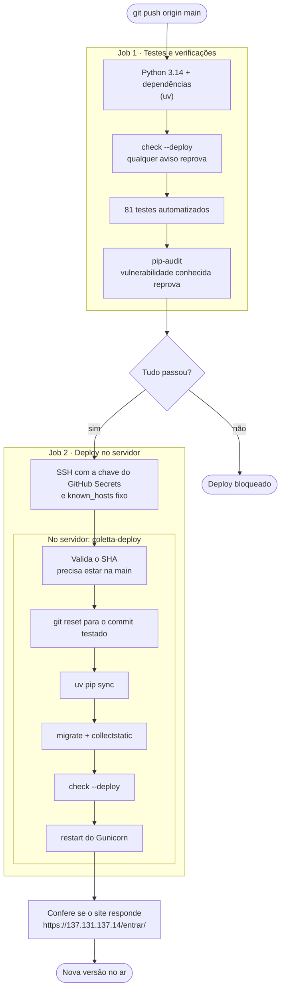

No servidor, o script [`deploy/coletta-deploy`](deploy/coletta-deploy) atualiza o código para o commit
recebido, instala dependências, aplica migrações, roda `collectstatic`, repete o `check --deploy` e
reinicia o Gunicorn.

**Credenciais e privilégio mínimo:**

- Credenciais apenas em **GitHub Secrets**: `SSH_PRIVATE_KEY`, `SSH_HOST`, `SSH_USER`, `SSH_KNOWN_HOSTS`.
  Nenhuma credencial aparece no workflow.
- A chave do servidor vem fixa do Secret `SSH_KNOWN_HOSTS` e o SSH roda com
  `StrictHostKeyChecking=yes`: o pipeline não se conecta a um servidor que se passe pelo real.
- A chave de deploy é **exclusiva do pipeline** e está restrita no `authorized_keys`:
  `restrict,command="/usr/local/bin/coletta-deploy"`. Ela não abre shell, não aloca terminal e não faz
  túneis; só consegue executar o script de deploy.
- O script só aceita um SHA de 40 caracteres que **já esteja na `origin/main`**.
- O usuário `coletta` tem `sudo` apenas para `systemctl restart coletta.service`
  ([`deploy/sudoers/coletta-deploy`](deploy/sudoers/coletta-deploy)).
- O token do GitHub no workflow tem permissão apenas de leitura (`contents: read`), e os deploys rodam
  um de cada vez (`concurrency`).

## 8. Repositório e proteção de segredos

- Repositório público no GitHub; commits por chave SSH e conta com 2FA.
- [`.gitignore`](.gitignore) bloqueia `.env`, chaves (`*.pem`, `*.key`, `id_rsa*`, `id_ed25519*`), banco
  local (`db.sqlite3`), cache, ambiente virtual e arquivos de IDE.
- O repositório contém apenas o modelo [`.env.example`](.env.example), sem valores reais.
- A `SECRET_KEY` gerada pelo `startproject` foi trocada antes do primeiro commit; a de produção foi
  gerada no próprio servidor e nunca saiu dele. No CI é gerada uma chave descartável a cada execução.

## 9. Desenvolvimento com IA

O projeto foi desenvolvido com o **Claude Code** (assistente de programação com IA no terminal), usado
para gerar, revisar e depurar o código e a configuração do servidor.

As regras passadas à IA estão em [`CLAUDE.md`](CLAUDE.md): requisitos da disciplina, regras de negócio e,
principalmente, as regras de segurança (toda consulta filtrada pelo dono, 404 para recursos de
terceiros, nada de segredos no código, nada de JavaScript inline). O andamento foi controlado pelo
[`PLANO.md`](PLANO.md).

Exemplos em que a IA ajudou na segurança:

- **Fail2Ban que não banía ninguém:** com senha desabilitada, o modo padrão ignorava as tentativas dos
  robôs. A IA propôs comparar os modos com `fail2ban-regex` no log real, o que levou ao `mode = aggressive`.
- **Contorno do bloqueio de login:** ao configurar o django-axes, foi descartado o `AXES_RESET_ON_SUCCESS`,
  que permitiria a um atacante com conta própria zerar o contador logando entre as tentativas.
- **IP falsificável:** atrás do Nginx, todos os acessos pareceriam vir do mesmo IP; a solução foi o
  `X-Real-IP` sobrescrito pelo Nginx e aceito só quando o sistema está atrás do proxy.
- **Pipeline com privilégio mínimo:** chave de deploy limitada a um único comando e `sudo` limitado a
  reiniciar o serviço.
- **Diagnóstico da CSP:** erros de fonte bloqueada no navegador foram identificados como recursos
  injetados por extensões (confirmado em janela anônima), e não como falha do site.
- **Permissões de arquivo por destino:** a primeira versão das capas definia `FILE_UPLOAD_PERMISSIONS = 0o600`
  de forma global. Como o `collectstatic` também usa essa configuração, o CSS publicado ficou ilegível para
  o Nginx (`www-data`) e o site perdeu o estilo em produção. A correção foi definir as permissões por destino
  em `STORAGES`: capas com `600/700` (só a aplicação lê) e arquivos estáticos com `644/755` (o Nginx serve).
- **Acessibilidade:** o contraste das cores do protótipo foi medido; o texto secundário reprovava no
  WCAG AA e foi escurecido.

### Auditoria de segurança com IA

Antes da entrega, a IA fez uma varredura completa comparando o projeto com o escopo da disciplina,
tanto no código quanto no ambiente de produção (visto de fora, como um avaliador veria):

| Verificação | Como foi feita | Resultado |
|---|---|---|
| Segredos no repositório | busca por `.env`, bancos, chaves e padrões de senha/token em **todo o histórico** do Git | nenhum segredo real |
| Controle de acesso | todas as views conferidas: `@login_required` e consulta filtrada pelo dono | 100% das views |
| Injeção e XSS | busca por SQL cru (`raw`, `extra`, `cursor`), `mark_safe`, `\|safe` e `innerHTML` | sem SQL cru; os usos restantes recebem só conteúdo gerado pelo servidor |
| Dependências | `pip-audit` no `requirements.txt` | nenhuma vulnerabilidade conhecida |
| HTTPS e TLS | `curl` e `openssl s_client` contra o IP público | HTTP → HTTPS (301); TLS 1.2/1.3; certificado Let's Encrypt para o IP |
| Cabeçalhos | `curl -I` em produção | CSP, HSTS, X-Frame-Options, nosniff e cookies `Secure` presentes |
| Exposição | acesso direto a `/admin/`, `/media/`, `.env` e `.git` | todos 404 |
| Portas | conexão às portas comuns (21, 22, 25, 80, 443, 3306, 5432, 8000, 8080) | só 22, 80 e 443 abertas |

Na publicação final, o problema de permissões dos arquivos estáticos (descrito acima) foi notado em produção e
diagnosticado com a IA, que o reproduziu localmente antes de corrigir.

## 10. Evidências

As capturas ficam em [`docs/evidencias/`](docs/evidencias/).

| Evidência | Arquivo |
|---|---|
| SSL.org: certificado confiável, assinatura e chave | 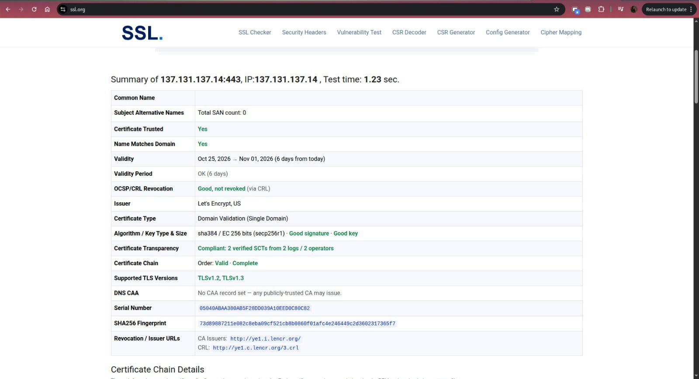 |
| SSL.org: cadeia de certificados | 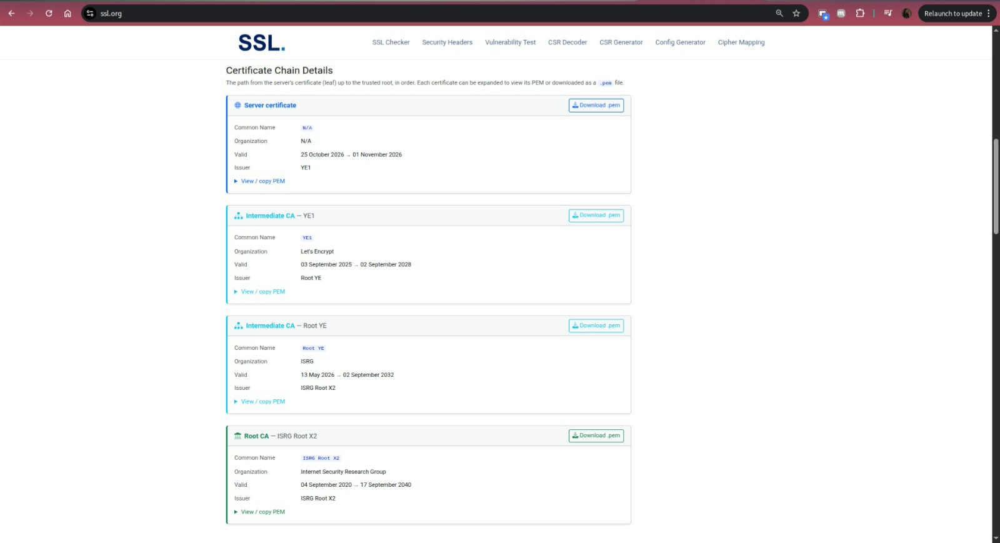 |
| DigiCert PQC checker: Pass | 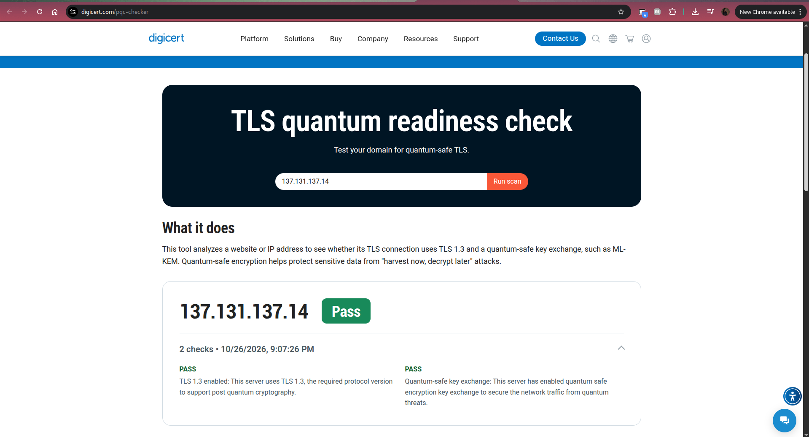 |
| Fail2Ban com IP banido | 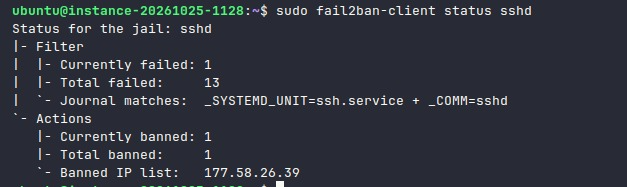 |
| SSH só com chave: tentativa de outro aparelho recusada (`Permission denied (publickey)`) | 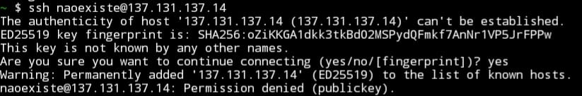 |
| Pipeline do GitHub Actions verde | 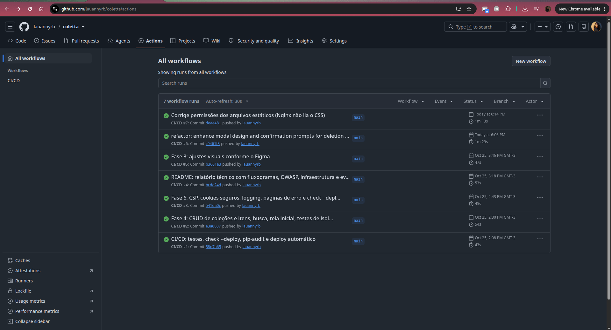 |
| Execução do pipeline: testes e deploy | 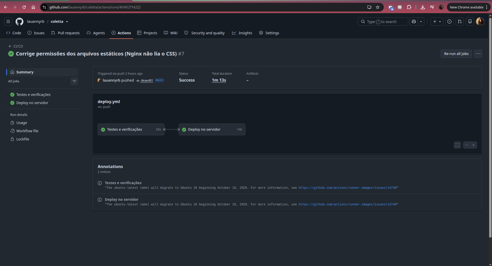 |
| Passos do deploy (incluindo apagar a chave do runner) | 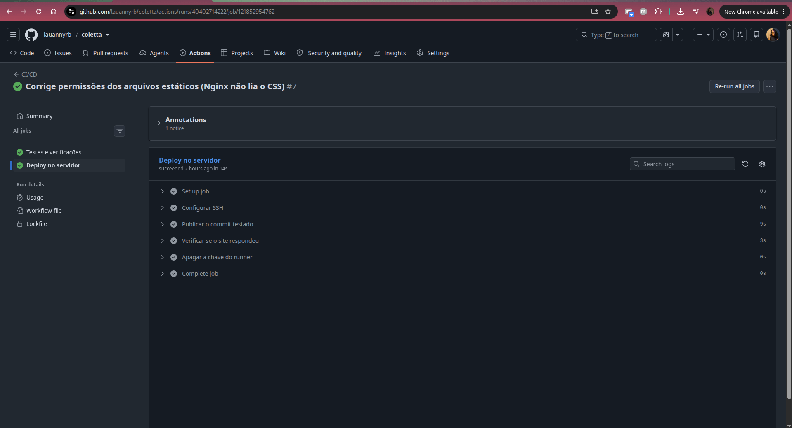 |
| Tela de login | 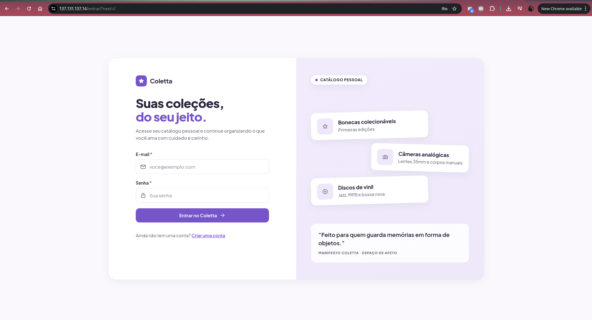 |
| Tela inicial em produção (página interna, após o login) | 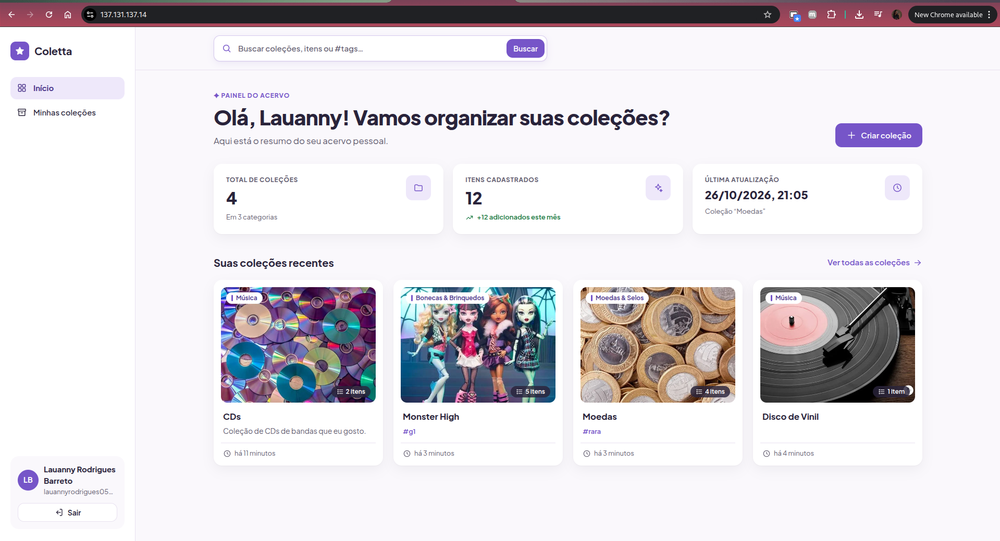 |
| Minhas coleções em produção (com capas) | 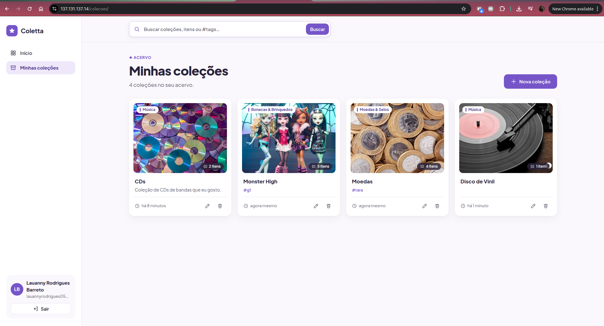 |

## 11. Decisões e limitações

- **HSTS no Nginx, não no Django:** o Nginx envia HSTS em todas as respostas. No Django, o
  `check --deploy` exigiria `includeSubDomains` e `preload`, que não se aplicam a um endereço IP; por isso
  o aviso `security.W004` foi silenciado, com a justificativa registrada em
  [`config/settings.py#L251`](config/settings.py#L251).
- **Certificado de 6 dias:** exigência da Let's Encrypt para IPs; depende da renovação automática.
- **CSP em desenvolvimento:** com `DEBUG=True` a CSP só registra violações (as páginas de erro do modo
  debug usam estilo inline); em produção ela bloqueia.
- **Debian x Ubuntu:** a Oracle Cloud não oferece imagem oficial do Debian; foi usado o Ubuntu Server LTS.
- **Rate limit do cadastro** usa cache em arquivo, compartilhado entre os workers do Gunicorn de um único
  servidor.
- **Pillow 13.0 e não 12.3:** a regra do projeto é preferir versões com pelo menos duas semanas de
  lançamento, mas o `pip-audit` apontou mais de 30 CVEs na 12.3, algumas alcançáveis no nosso fluxo (parsers
  de XBM e GIF executados durante o `Image.open`, EXIF lento em PNG), todas corrigidas na 13.0. Uma falha
  conhecida pesa mais que o risco de uma versão recente; além disso, o `Image.open` foi restrito aos
  formatos permitidos.
- **Fora do escopo da v1:** recuperação de senha por e-mail, imagens nos itens (só a coleção tem capa),
  compartilhamento público e mover itens entre coleções.

## 12. Checklist da entrega

- [x] Aplicação no ar pelo IP público (https://137.131.137.14)
- [x] Nginx com HTTPS (Certbot/Let's Encrypt) e redirecionamento automático de HTTP para HTTPS
- [x] TLS conforme: SSL.org (certificado confiável, *Good signature*, *Good key*) e PQC confirmado no DigiCert
- [x] SSH somente com chave e Fail2Ban na porta 22 (4 tentativas, 24h)
- [x] Código em repositório público no GitHub, conta com chave SSH e 2FA
- [x] `.gitignore` configurado, sem chaves ou senhas expostas
- [x] Login, página interna e logout, desenvolvidos com auxílio de IA
- [x] README com as categorias da OWASP mitigadas e onde estão no código
- [x] Deploy automático com GitHub Actions
